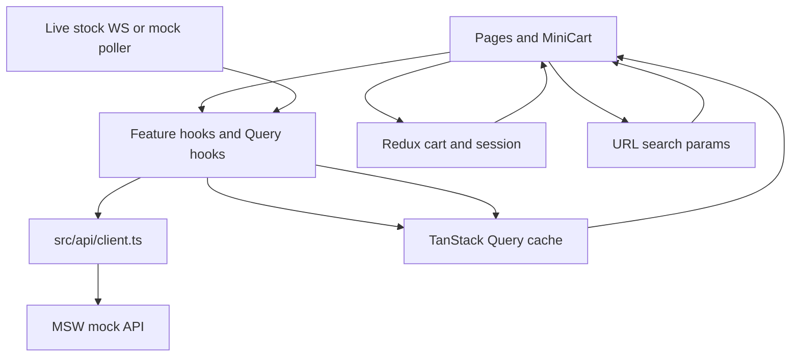

# Architecture — The Bug Bazaar

## Folder structure

```
bug-bazaar/
  src/
    api/           Typed fetch client, Zod schemas, request status, error → UI mapping
    auth/          RequireAuth, return-to helpers, unauthorized subscriber
    components/    Shell (AppLayout), AsyncStatusView, AppErrorBoundary
    features/
      browse/      List, details, filters, sidebar filters, product card
      cart/        Cart page, MiniCart, checkout idempotency helpers
      auth/        Login, account
      stock/       Live stock WebSocket hook + cache patch
      dev/         Mock API guide page
    hooks/         useDebouncedValue, useBackToTop
    mocks/         MSW handlers, 5,000-product seed, Vitest server
    monitoring/    reportError (safe logging)
    query/         TanStack Query client, keys, hooks
    store/         Redux Toolkit cart + session
    theme/         Ant Design tokens + ConfigProvider config
    styles/        SCSS variables + global entry
  docs/            Contract, decisions, AI notes, day guides, this file
  public/          Logo + local product SVGs
```

## Where state lives

| Kind | Home | Examples |
| --- | --- | --- |
| Server state | TanStack Query (`src/query/`) | Product lists/details, `/me`, order confirmation. `queryFn` calls `src/api/client.ts` only. `staleTime` 30s for products/me. |
| Client state | Redux Toolkit (`src/store/`) | Cart lines (persisted to `localStorage`), session `user`. Token is **not** in Redux — memory only via the API client. |
| URL state | React Router `useSearchParams` | Search, category, sort, inStock, page. Sidebar filters write the same params. |
| Ephemeral UI | Local React state | Login submit flag, cart drawer open, error boundary flag. |

## Data flow



Browse reads filters from the URL, loads products through Query → client → MSW, and shows cards. Cart updates go to Redux (and `localStorage` for lines only). Checkout calls `createOrder` with an idempotency key, then invalidates product queries. Live stock patches the Query cache and the in-memory catalog without a new REST endpoint.

## Choice to defend

**Native `fetch` wrapper instead of Axios.** Six contract endpoints; the week scores status codes, abort, and error mapping. A short client teaches that. MSW mocks `fetch` directly. TanStack Query is the cache, not the HTTP stack.

## Design patterns

### 1. Adapter — typed API client

`src/api/client.ts` is the only module that calls `fetch`. Zod schemas validate success and error payloads. Features import `getProducts`, `login`, `createOrder`, and never invent endpoints. This adapts the HTTP contract into typed functions the UI can call.

### 2. Container / presentational

`ProductListPage` owns Query status, pagination, and live-stock wiring. `ProductCard` is a memoized presentational card: product props in, keyboard-friendly Ant Design `Card` out. Keeping the card dumb makes list re-renders cheaper when the cart badge updates.

### 3. Custom hooks

- `useDebouncedValue` — search draft → URL without network code.
- `useBackToTop` — scroll listener + cleanup on the details page.
- `useLiveStock` — WebSocket in Vite DEV (or `VITE_STOCK_WS_URL`); mock poller on static hosts with mocks; reconnect / unmount stop.

Hooks sit **above** the typed client. They are not a second HTTP layer.
