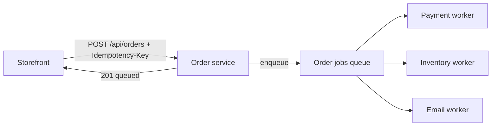

# Order flow — queues and workers

How a placed Bug Bazaar order would move through services once the mock becomes a real backend.

## Happy path

1. The client sends cart lines plus an **idempotency key** (D3-2).
2. The order service records the order as `queued` and enqueues jobs for payment, inventory, and email.
3. Workers run independently. The UI can poll `GET /api/orders/:id` for status.

## Why a queue helps

Checkout returns quickly (`201 queued`) while slow work happens off the request path. Payment, stock decrement, and email can retry without blocking the shopper. Load spikes hit the queue depth, not the web tier alone.

## If email is down

Payment and inventory can still succeed. Email jobs stay on the queue (or a dead-letter queue) until the mail provider recovers. The order is not rolled back because a receipt failed — the shopper already has an order id. Ops alert on email lag separately.

## Double charges and D3-2

The storefront keeps one idempotency key per checkout attempt and reuses it on Retry. The order service treats the same key as the same order, so a double-click or network retry does not create a second charge or a second inventory decrement. That client key is what stops the “two orders from one checkout” bug in this training app; a production payment worker would also key off the same idempotency token when talking to the payment provider.
